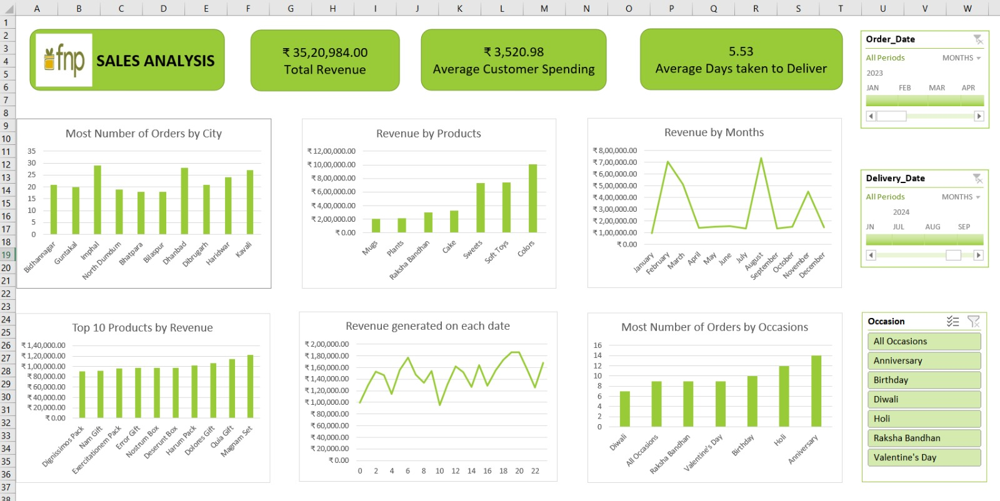

# FNP-Sales-Analysis

# FNP Gifting Sales Analysis (2023)

An interactive Excel dashboard on revenue, products, occasions, cities and delivery speed for an online gifting business, built on a three-table data model.

**Tools:** Excel · Power Query · Data Model (3 related tables) · Pivot Tables · Charts · Timeline Slicers and Slicers · Formulas

**Quick links:** [Full report (PDF)](FNP_Sales_Report.pdf) · [Excel dashboard](FNPDashboard.xlsx) 

---

## Business problem

An online gifting business sells across many occasions and depends on timely delivery. Management needs to know which products, occasions, cities and months drive revenue, and whether delivery is consistent, so stock and marketing can be planned around peak dates. The data is split across three tables (orders, customers, products) that must be combined before analysis. This project joins them and answers these questions in one dashboard.

## Key numbers

| Total revenue | Orders | Average value per order | Average delivery time |
|---|---|---|---|
| ₹35,20,984 (₹35.21 lakh) | 1,000 | ₹3,521 | 5.53 days |

## Key findings

- **Four festival peaks drive revenue:** February, March, August and November deliver 68.2% of annual revenue; Valentine's Day, Holi, Raksha Bandhan and Diwali alone bring ₹18.52 lakh (52.6%).
- **Three categories make up 70% of revenue:** Colors (28.6%), Soft Toys (21.0%) and Sweets (20.8%).
- **No single hero product:** the top 10 products together earn only 28.8% of revenue across 70 products.
- **Anniversary is the biggest occasion** (205 orders), while **Raksha Bandhan has the highest value per order** (₹4,785).
- **Demand is spread across 86 customer cities,** led by Imphal, Dhanbad and Kavali; the top city holds just 2.9% of orders.
- **Delivery is inconsistent:** only 29.3% of orders arrive within 3 days and 31.9% take 8 to 10 days. Quantity and delivery time are uncorrelated (r = 0.003).

## Recommendations

1. Plan stock and campaigns three to four weeks before the four festival peaks.
2. Fill off-season months with Anniversary and Birthday promotions.
3. Concentrate on Colors, Soft Toys and Sweets, and bundle low-value Plants and Mugs with them.
4. Set a delivery standard (for example 3 to 5 days) and investigate delays by location and processing step.
5. Keep growing in smaller cities where demand already exists.

## Approach

1. Imported three CSV files with **Power Query** into Excel tables and the Data Model.
2. Related the tables through `Customer_ID` and `Product_ID`.
3. Created calculated fields: `Revenue = Price × Quantity`, `Time Taken to Deliver` (days), `Hour of Order`, `Hour of Delivery`, `Weekday of Order`, `Month Name`.
4. Built ten pivot tables and six charts (bar and line).
5. Added Timeline slicers (Order Date, Delivery Date) and an Occasion slicer; assembled KPI cards and charts on one dashboard sheet.

## Dataset

- Public practice dataset themed on FNP (Ferns N Petals). **Records are synthetic** (placeholder names and descriptions); this is not real FNP data.
- `orders.csv` (1,000 rows), `customers.csv` (100 rows), `products.csv` (70 rows, 7 categories, 7 occasions)
- Orders placed 1 Jan to 29 Dec 2023; deliveries 2 Jan 2023 to 7 Jan 2024
- Checks: no duplicate order IDs, no unmatched products, no blank cells

## Repository contents

| File | Description |
|---|---|
| [`FNP_Sales_Report.pdf`](FNP_Sales_Report.pdf) | Full report: problem, method, findings, recommendations, limitations |
| [`FNP_Sales_Dashboard.xlsx`](FNP_Sales_Dashboard.xlsx) | Excel workbook with the data model, pivot tables and dashboard |
| [`data/`](data/) | Source CSV files (orders, customers, products) |
| [`images/dashboard.jpeg`](images/dashboard.jpeg) | Dashboard screenshot |

## How to open the dashboard

Download the `.xlsx` file and open it in desktop Excel (2016 or later; the Data Model and timeline slicers need the desktop version). Use the timelines and the Occasion slicer on the **Dashboard** sheet to filter every chart and KPI.

## Limitations

- **Synthetic data:** patterns such as festival products selling only in festival months, and 100 customers placing about 10 orders each, reflect how the dataset was generated. Validate on real data before business decisions.
- Revenue is Price × Quantity; there are no discounts, costs or margins.
- The ₹3,521 KPI is revenue per **order**; revenue per customer would be ₹35,210.
- One year of data, so no year-over-year comparison.

---

**Author:** Abhijit Sharma · Part of the [Excel Data Analytics Portfolio](../README.md)
